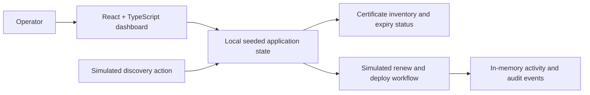
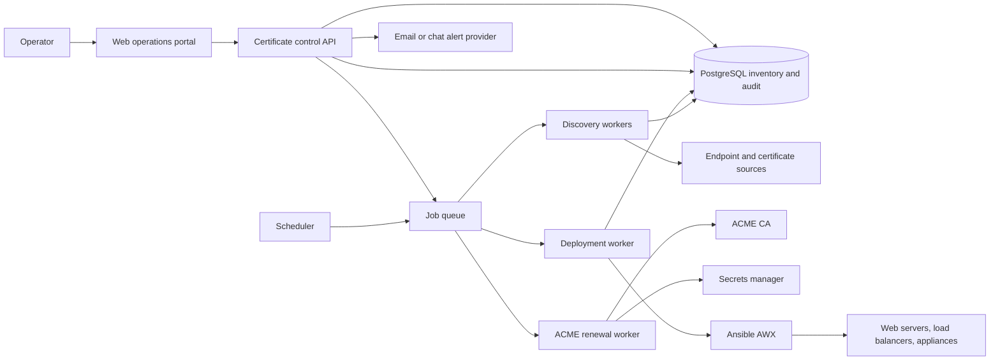

# Architecture

## Prototype architecture

This assignment prototype runs entirely in the browser. Seed data and state transitions are defined in `src/App.tsx`. Reloading the page resets the demo state. The prototype does not connect to external systems.

## Production-oriented target architecture

The target design separates the operator portal from privileged workers. A production implementation should use authenticated API access, role-based authorization, encrypted secret references, durable queued jobs, idempotent deployment operations, retry and rollback policies, and append-only audit events. ACME account keys and private keys must remain in a secrets manager and must never be exposed to the browser.

## Workflow

1. Discovery workers retrieve certificate metadata and endpoint ownership, then normalize it into the inventory.
2. Expiry policies calculate risk and create alert/deployment work before the configured renewal threshold.
3. An ACME worker completes HTTP-01 or DNS-01 validation and stores certificate material through the secrets manager.
4. A deployment worker applies the renewed certificate using an approved endpoint adapter or AWX job.
5. Health checks verify the deployed certificate, and the API records success/failure plus an audit event.

The prototype demonstrates the operator-facing inventory and state transitions only; the integrations and worker architecture above are design intent, not implemented services.
